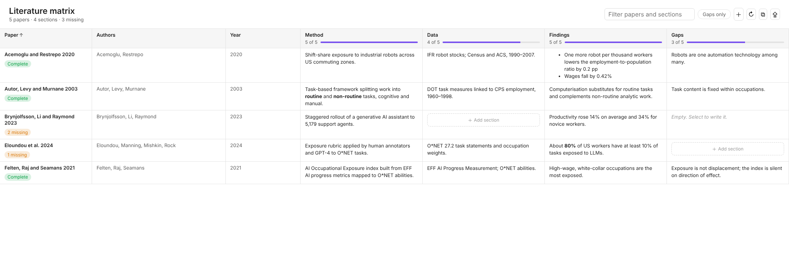

# Literature Matrix

A synthesis matrix for your literature notes. Each paper is a row. Each section you care about, such as Method, Data, Findings and Gaps, is a column. You read across a row to see one paper and down a column to compare every paper on the same question.



## What it does

- **Builds the matrix from your own notes.** It reads the headings you already write in literature notes and pulls the text under each one into its column. Nothing is copied or duplicated.
- **Shows where the gaps are.** Every column shows how many papers cover it. Each paper gets a badge: complete, or the number of sections still missing.
- **Fixes gaps in one click.** A missing section has an "Add section" button that adds the heading to the note and opens the note there.
- **Opens the source.** Select any cell to jump to that heading in the note.
- **Filters and sorts.** Search across titles, properties and section text, show only papers with gaps, and sort by title or by any property such as year.
- **Exports.** Save the matrix as a Markdown table in a new note, or copy it as CSV for a spreadsheet.
- **Creates new literature notes** with your columns already in place as headings.

It works offline, on desktop and mobile, and never sends your notes anywhere.

## How to use it

1. Open **Settings → Literature Matrix** and choose the folder your literature notes live in, a tag such as `#paper`, or both.
2. Open the matrix from the ribbon icon or run **Literature Matrix: Open matrix** from the command palette.
3. Write your notes with headings that match your columns:

```markdown
---
authors: Autor, Levy, Murnane
year: 2003
tags: [paper]
---

## Method
Task-based framework splitting work into routine and non-routine tasks.

## Data
DOT task measures linked to CPS employment, 1960–1998.

## Findings
Computerisation substitutes for routine tasks.

## Gaps
Task content is fixed within occupations.
```

Heading level does not matter, and the match ignores case and a trailing colon. A section runs until the next heading of the same or a higher level, so subheadings stay inside their section.

## Settings

| Setting | What it does |
| --- | --- |
| Folder | Only include notes in this folder and its subfolders. Leave empty for the whole vault. |
| Tag | Only include notes with this tag. Nested tags count, so `#paper` also matches `#paper/labour`. |
| Sections | The columns, separated by commas. Use `\|` to give one column several heading names. The default is `Method\|Methods\|Methodology, Data\|Dataset\|Sample, Findings\|Results, Gaps\|Limitations`. |
| Properties | Frontmatter properties shown next to each paper, such as `authors, year, venue`. |
| Render Markdown in cells | Show links, lists and formatting in cells. Turn it off for plain text in very large vaults. |

A note's `title` property is used as its name in the matrix when it has one. Otherwise the file name is used.

## Commands

- **Open matrix**
- **Create literature note**
- **Export matrix to a note**
- **Copy matrix as CSV**

Exported matrix notes carry a `literature-matrix-export` property so they never appear as papers in the matrix.

## Install

Search for **Literature Matrix** in **Settings → Community plugins → Browse**, then select Install and Enable.

To install by hand, download `main.js`, `manifest.json` and `styles.css` from the latest release into `<your vault>/.obsidian/plugins/literature-matrix/`, then enable the plugin in Settings.

## Build from source

```bash
npm install
npm run build
```

## License

MIT © Dev Das
